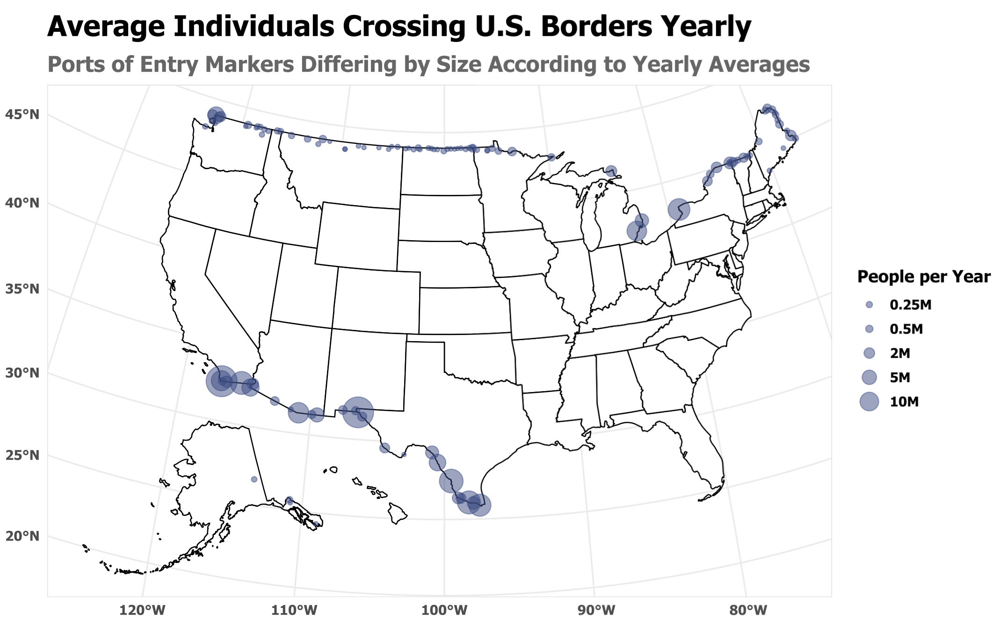
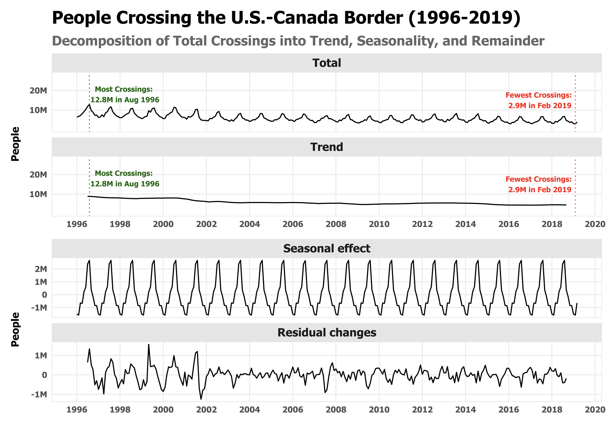
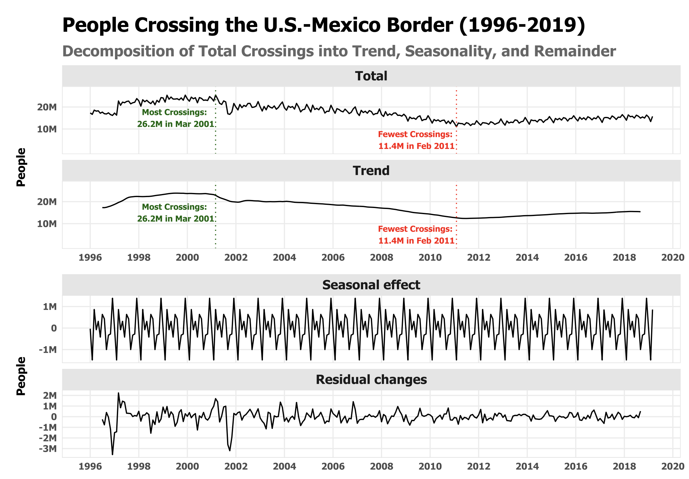
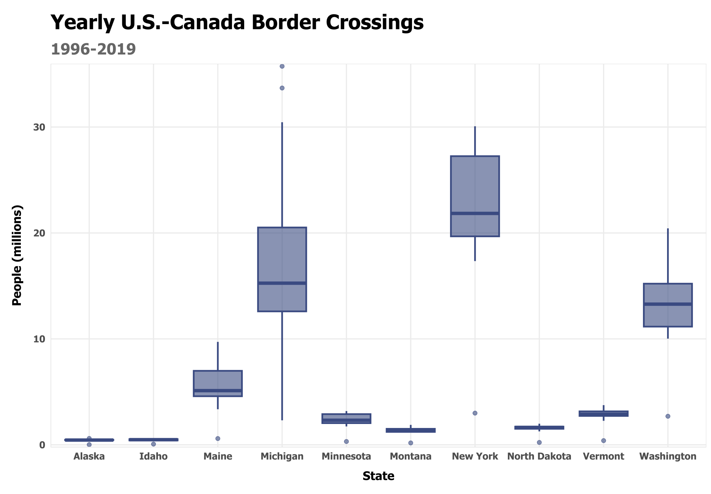
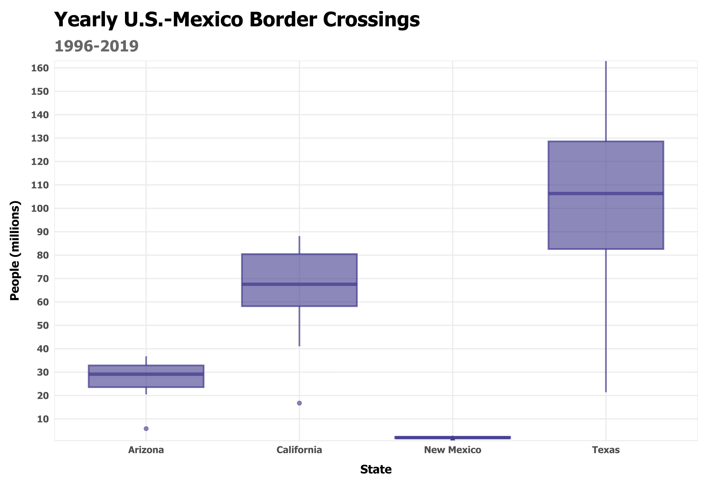

# Visualizing Border Crossings into the U.S.

## Data and Scope

This project uses the [U.S. Department of Transportation's Bureau of Transportation Statistics (BTS) Border Crossing/Entry Data](https://www.kaggle.com/datasets/akhilv11/border-crossing-entry-data), which records inbound crossings at official land ports along the U.S.–Canada and U.S.–Mexico borders. The analysis covers 1996–2019 and focuses on measures intended to capture the movement of people, rather than freight or vehicle traffic alone.

The dataset provides monthly counts by port of **entry** and crossing method. These records describe crossing events, not unique individuals: a person who crosses the border repeatedly may be counted multiple times. The data therefore capture patterns in recorded border activity, not the number of distinct people entering the country or the extent of permanent migration.

## Chief Inquiries

This project seeks to employ R packages to identify human border crossings into the U.S. across border states between 1996 and 2019, with main questions including:

- What is the overall trend in U.S. entries over land borders?
- Which border entry locations are busiest/allow the largest flow of migrants?
- In which years/seasons are the border crossings at their highest?
- Are there visible changes in the residuals over time marking historic changes in migration (e.g. post-9/11 crackdowns)?
- How do entry rates on the Canadian border compare to those of the Mexican border?

## R Visualization Packages

Chiefly employed R packages in this project include:

```
tidyverse
ggplot2

patchwork  # plot combined placement
ggfortify  # time-series creation
usmap      # plotting lat-long points on US map


# Textual packages for custom theme
ggtext
showtext
purrr
systemfonts
```

## Outputs

Average yearly entries per port are summarized in the following map:



Entries from Canada and entries from Mexico trends over time are summarized here with high and low points marked distinctly:

<p align="center">
  
  
</p>

Likewise, state-by-state comparisons of entries from Canada and Mexico are summarized in these boxplots:

<p align="center">
  
  
</p>

## Findings

1. The two borders follow different long-term trajectories

The time-series decompositions reveal distinct trends in inbound crossings along the northern and southern borders.

- **U.S.–Canada:** The overall trend declines across much of the study period, with the reduction particularly apparent in the early 2000s. The highest monthly total shown is 12.8 million in August 1996, while the lowest is 2.9 million in February 2019.

- **U.S.–Mexico:** Crossings rise toward a peak around the turn of the century before declining through the late 2000s and early 2010s. The series reaches its highest monthly total of 26.2 million in March 2001 and its lowest of 11.4 million in February 2011, followed by a partial recovery through 2019.

These contrasting trajectories demonstrate why the two borders should not be assumed to follow a single pattern of cross-border movement.

2. Seasonal variation is an important feature of border activity

Both time series exhibit recurring within-year fluctuations in addition to their longer-term trends. Seasonality is particularly apparent in the U.S.–Canada series, where repeated peaks and troughs recur throughout the study period.

Separating the trend, seasonal component, and residual variation helps distinguish recurring fluctuations from longer-term changes and unusual deviations. 

3. Border activity is geographically concentrated

The map of average annual crossings reveals substantial differences among ports of entry. Along the southern border, larger volumes are concentrated at major ports in California, Arizona, and Texas. Along the northern border, substantial activity is concentrated at particular ports associated with major Great Lakes and northeastern crossing corridors.

The state-level boxplots reinforce this geographic variation. Texas has by far the highest annual crossing totals among the states along the U.S.–Mexico border, followed by California and Arizona. On the U.S.–Canada border, New York and Michigan have especially high annual totals.

These distributions show that aggregate border figures conceal meaningful differences among individual states and entry corridors. The boxplots also demonstrate that annual volumes vary considerably over time, particularly in states with higher overall crossing counts.

4. Residual variation highlights time-specific changes worthy of investigation

The residual components contain fluctuations that are not captured by the estimated trend and seasonal patterns. These deviations are particularly pronounced during parts of the late 1990s and early 2000s, although their timing and magnitude differ between the two borders.

Historical events (see the dip in residuals toward the end of 2001 following 9/11), policy changes, and economic conditions may offer useful context for investigating these deviations. However, the decompositions alone cannot establish whether a particular event caused a change in crossing activity. Such explanations would require additional historical evidence and more systematic analysis.

## Limitations

### Measuring crossings rather than migration

The data measure recorded crossing events, not unique individuals. Repeat travelers may contribute multiple entries, and the dataset does not establish whether a crossing represents tourism, commuting, business travel, immigration, or another purpose.

Consequently, these visualizations should not be interpreted as direct measures of immigration, emigration, undocumented migration, or permanent resettlement. They also cannot distinguish U.S. citizens from noncitizens or identify the legal status of travelers.

### Incomplete coverage of cross-border movement

The dataset covers inbound activity at official U.S. land ports along the Canadian and Mexican borders. It does not provide comparable outbound counts and does not capture the entirety of international movement through airports, seaports, or locations between official ports of entry. The findings therefore describe a specific part of cross-border activity rather than all movement into or out of the United States.

### Aggregation obscures local variation

Monthly time series provide an overview of broad trends but may conceal short-lived changes at particular ports. Similarly, state-level totals combine multiple entry locations and do not account for differences in population, infrastructure, port capacity, or the number of ports within each state.

The resulting comparisons describe the volume and distribution of recorded crossings, not the likelihood that an individual will cross at a particular location or the relative efficiency of different ports.

### Descriptive patterns do not establish causation

Time-series decomposition can identify trends, recurring seasonal variation, and deviations from expected patterns, but it cannot explain their causes by itself. For example, though interesting to note, the change in residuals near September 11, 2001, does not independently demonstrate a direct effect of subsequent security or immigration policies.

Establishing such relationships would require additional contextual data, explicit hypotheses, and a research design capable of distinguishing policy effects from other influences, including economic conditions and changes in travel behavior.
